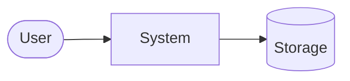
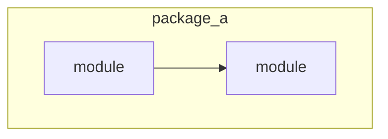
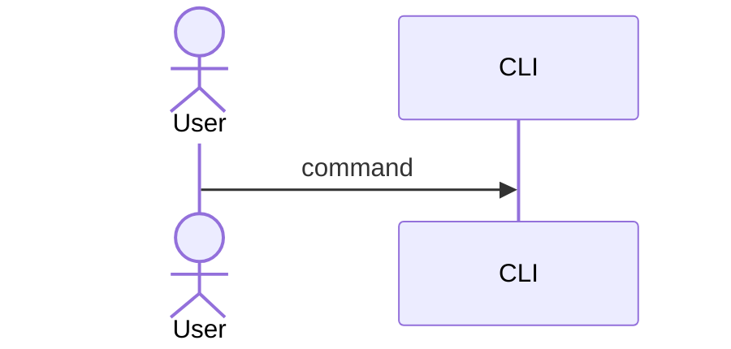
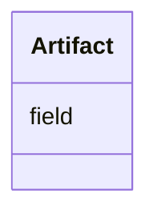
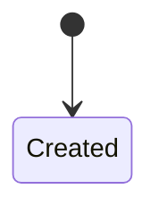
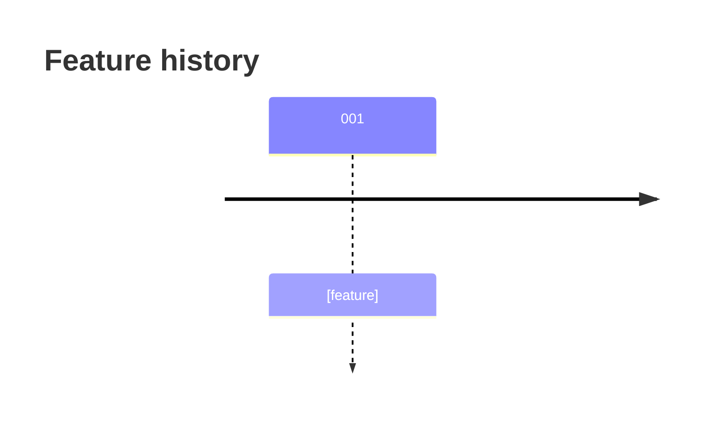

# High-Level Design: [PROJECT NAME]

| | |
|---|---|
| **Status** | Living document, regenerated by `/speckit-hld-generate` |
| **Updated** | [YYYY-MM-DD] at commit `[SHORT_SHA]` |
| **Features covered** | [001-slug, 002-slug, …] |
| **Audience** | [New contributors, reviewers, …] |
| **Sources** | [constitution, requirements doc, specs/*, src/*] |

<!--
  Filling rules (remove this comment in the output):
  - Diagrams first, prose second. Explain *why*, not line-by-line *how*.
  - Mermaid only, GitHub-compatible syntax (no animated edges here).
  - Every claim must trace back to the code, a spec artifact, or the constitution.
  - Mark unknowns as: > **Open question:** …
-->

## 1. Purpose and scope

[Two or three sentences: what the system does, for whom, and what is explicitly out of scope.]

## 2. Guiding principles

[One line per constitution principle and how it shapes the design.]

## 3. System context

[Who and what interacts with the system: users, files, containers, external services.]

## 4. Building blocks

[Packages or modules and their single responsibility. Group by deployable unit.]

| Module | Responsibility | Introduced by |
|---|---|---|
| [path] | [one line] | [feature] |

## 5. Key flows

[One subsection per end-to-end flow. Use a flowchart for pipelines and a sequenceDiagram for
interactions between components.]

### 5.1 [Flow name]

## 6. Core model or algorithm

[The central algorithm or model (for example a network architecture), shown as a diagram with its
key hyperparameters.]

## 7. Data and artifacts

[What is stored, its layout and format, and how it changes over time.]

## 8. Runtime and deployment

[Container image, entry points, volumes, pinned versions, supported platforms.]

## 9. Quality attributes

| Attribute | How the design achieves it | Evidence |
|---|---|---|
| Reproducibility | | |
| Correctness and safety | | |
| Testability | | |

## 10. Results and limitations

[Measured results with honest caveats. Never present training metrics as generalization.]

## 11. Decision log

| # | Decision | Why | Source |
|---|---|---|---|
| D1 | | | [specs/NNN/research.md](../../specs/NNN/research.md) |

## 12. Evolution

## 13. Open questions and roadmap

- [Open question or planned feature]

## Glossary

| Term | Meaning |
|---|---|
| | |
