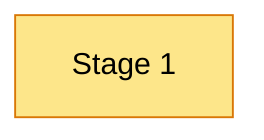
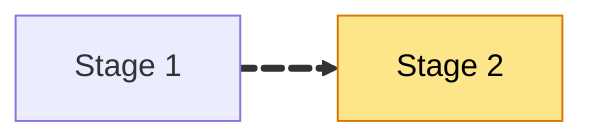
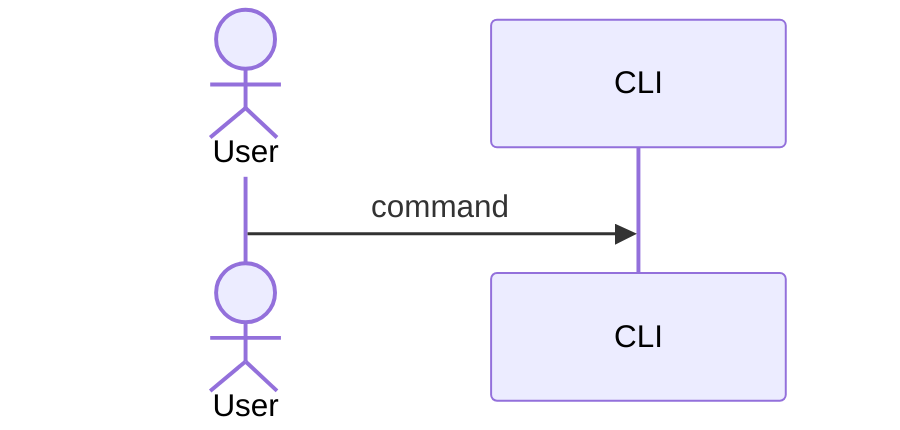

<!--
  docs/hld/package.json (create if missing):
  {
    "name": "hld-slides",
    "private": true,
    "type": "module",
    "scripts": {
      "dev": "slidev slides.md --open",
      "build": "slidev build slides.md",
      "export": "slidev export slides.md"
    },
    "devDependencies": {
      "@slidev/cli": "53.0.0",
      "@slidev/theme-default": "0.25.0"
    }
  }

  Animation toolbox:
  - <v-clicks> … </v-clicks>        reveal list items one by one
  - 
 … 
          reveal a block on the next click
  - x  hand-drawn highlight
  - build-up diagram: repeat a Mermaid diagram over several slides, adding one stage each time
  - animated edge (Mermaid 11):  A e1@==> B   then   e1@{ animate: true }
-->

# [PROJECT NAME]

High-Level Design

[date] · commit [sha]

<!-- Speaker notes: one-sentence pitch of the system. -->

---

# What it does

<v-clicks>

- [Point 1]
- [Point 2]
- [Point 3]

</v-clicks>

---

# The pipeline, step 1

---

# The pipeline, step 2

---
layout: two-cols
---

# Diagram with explanation

::right::

<v-clicks>

- [What happens first]
- [What happens next]

</v-clicks>

---
layout: center
---

# Questions?
