# High-Level Design: Synthetic Shape Classifier

| | |
|---|---|
| **Status** | Living document, regenerated by `/speckit-hld-generate` (Codex: `$speckit-hld-generate`) |
| **Updated** | 2026-11-07 at commit `83b41d9` |
| **Features covered** | 001-generate-shape-dataset, 002-cnn-training-prediction, 003-improve-default-training, 004-device-benchmark, 005-high-level-design |
| **Audience** | New contributors, reviewers, and anyone learning how the pieces fit together |
| **Sources** | [constitution](../../.specify/memory/constitution.md), [requirements](../../CNN_image_classification_research.md), [`specs/`](../../specs), `src/`, `Dockerfile`, `requirements.txt` |
| **Slides** | [`slides.md`](slides.md): run `npm install && npm run dev` in this folder |

## 1. Purpose and scope

The system is a small learning project. It **generates synthetic images** of filled circles,
rectangles and triangles, **trains a tiny convolutional neural network (CNN)** on them, and then
**classifies new images** into one of those three shapes. It is reproducible from fixed seeds.

Docker on the CPU is the default runtime. An **optional native macOS mode** runs the same code
and package versions directly on the Mac, on its CPU or its GPU (MPS). Every training run is
recorded, and a **benchmark summary** compares Docker CPU, native CPU and native MPS.

**Out of scope today:** real-world photos, more classes, serving a model over a network,
hyperparameter search, and running commands concurrently against the same outputs.

## 2. Guiding principles

The [constitution](../../.specify/memory/constitution.md) shapes every design choice:

| Principle | What it means for the design |
|---|---|
| **I. Simplicity** | Two small Python packages, a ~5k-parameter CNN, the standard library `unittest`, no framework on top of PyTorch and no new dependency for benchmarking |
| **II. Reproducibility** | Fixed, overridable seeds (data 42/43, training 42); pinned Python 3.14.10 and one shared set of package pins; deterministic algorithms where supported; Docker as the default runtime. Known limits are documented: multithreaded CPU and MPS runs are not bit-identical |
| **III. Honest evaluation** | A separate **held-out** set is always reported next to training accuracy and is never used to pick models or settings. Benchmark results are published as measured |
| **IV. Shared preprocessing** | Training, evaluation and prediction import **one** preprocessing definition, on every device |
| **V. Conventional Commits** | Enforced by a `commit-msg` hook; a `pre-commit` hook keeps feature numbers, specs and the README in sync (see [`AGENTS.md`](../../AGENTS.md)) |

## 3. System context

One person runs commands either in Docker or natively on the Mac. Both environments share the
same `data/` folder, so they see the same images, checkpoint and benchmark results.

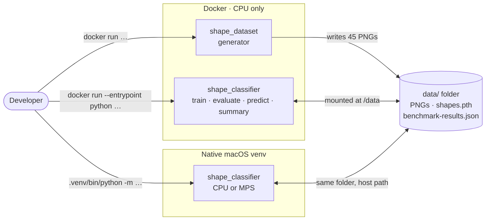

Commands that touch the same checkpoint or results file must run **one at a time**. Overlapping
access is unsupported and is not detected.

## 4. Building blocks

The code is two packages. `shape_dataset` knows nothing about machine learning;
`shape_classifier` only depends on the folder layout the generator produces.

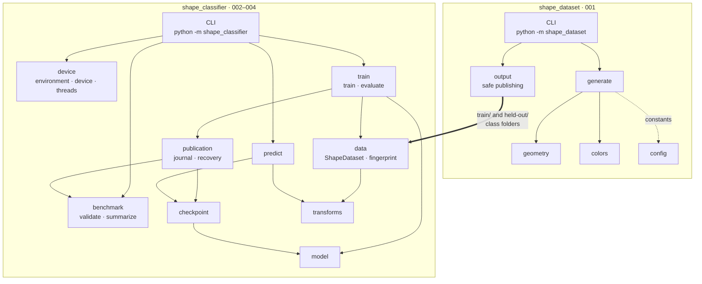

| Module | Responsibility | Introduced by |
|---|---|---|
| `shape_dataset/config.py` | Canvas size (1920×1080), class names, images per set, default seeds | 001 |
| `shape_dataset/geometry.py` | Samples one shape inside the canvas with size, rotation and angle limits | 001 |
| `shape_dataset/colors.py` | Random background and foreground with contrast of at least 3:1 | 001 |
| `shape_dataset/generate.py` | Draws every image in memory, guarantees variation within each set | 001 |
| `shape_dataset/output.py` | Lock, stage, journal and atomically publish images; recover after interruption | 001 |
| `shape_classifier/transforms.py` | The one shared `preprocess` pipeline and the training-only `augment` pipeline | 002 |
| `shape_classifier/data.py` | Validates the folder layout, caches preprocessed tensors, fingerprints both splits (SHA-256) | 002, 004 |
| `shape_classifier/model.py` | The CNN architecture, used for both training and loading | 002 |
| `shape_classifier/device.py` | Detects Docker vs native, resolves `auto` / `cpu` / `mps` (probing that MPS actually works), counts available CPUs and Docker VM resources | 004 |
| `shape_classifier/train.py` | Training on the resolved device with warm-up-excluded timing, held-out inference timing and paired assessment | 002, 003, 004 |
| `shape_classifier/benchmark.py` | Validates versioned benchmark entries; groups comparable runs and prints the summary table | 004 |
| `shape_classifier/publication.py` | Publishes checkpoint then results with a durable journal; recovers interrupted publications | 004 |
| `shape_classifier/checkpoint.py` | Portable save (CPU tensors, actual environment and device); strict validation; triggers pending recovery before loading | 002, 004 |
| `shape_classifier/predict.py` | Classifies one image on the resolved device using the checkpoint's class order | 002, 004 |

## 5. Key flows

The whole system is one pipeline. Each stage is a separate command, so stages can be re-run
independently and in either environment.

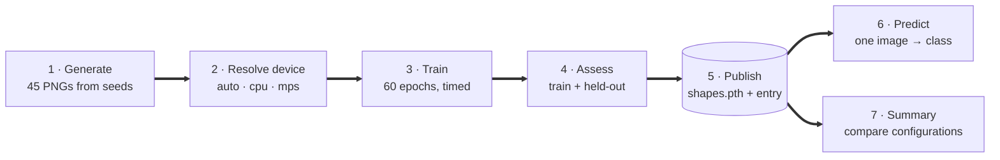

### 5.1 Generate the dataset

Each set (training, held-out) has its own random generator, so changing one seed never changes
the other set. A candidate shape is redrawn until it satisfies every rule.

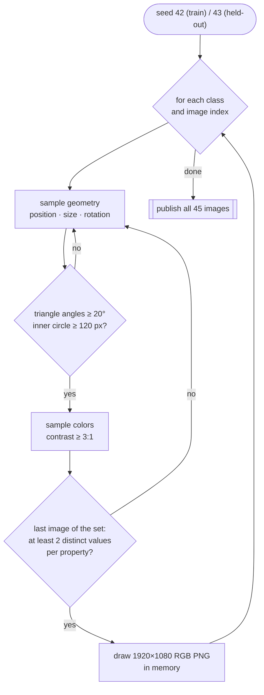

Publishing never leaves the folder half-written and never deletes files it did not create:

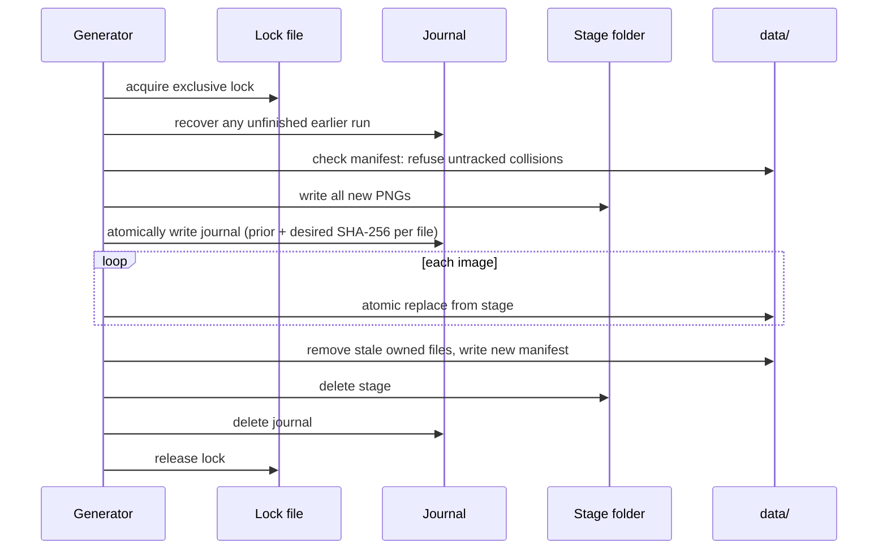

If the process is killed at any step, the next run finds the journal and completes it before
doing anything else.

### 5.2 Choose the device

The device is resolved **before** any data is loaded or any file is written, so an impossible
request never leaves a partial result.

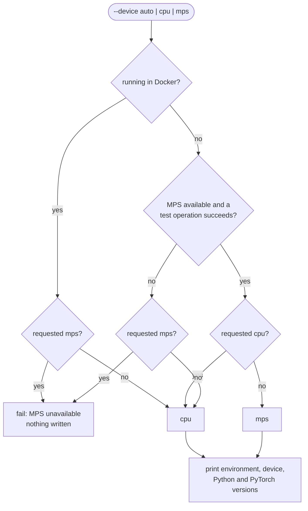

### 5.3 Train, assess and record

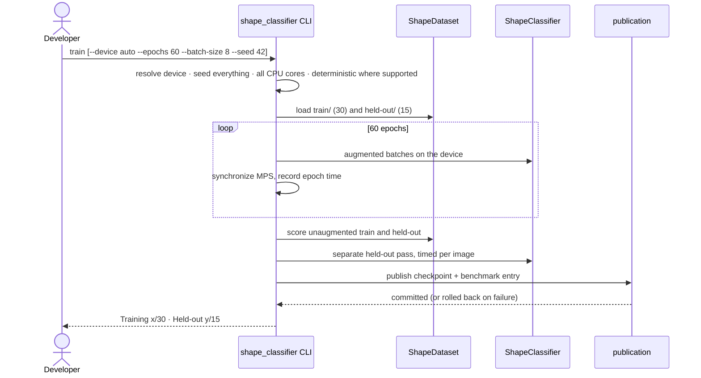

The first epoch is excluded from training times, because it includes one-off warm-up costs.
With a single epoch those times are recorded as unavailable, not zero.

### 5.4 Publish checkpoint and results

A new checkpoint and its benchmark entry go to two different files, which cannot be replaced
in one atomic step. A journal makes the pair recoverable:

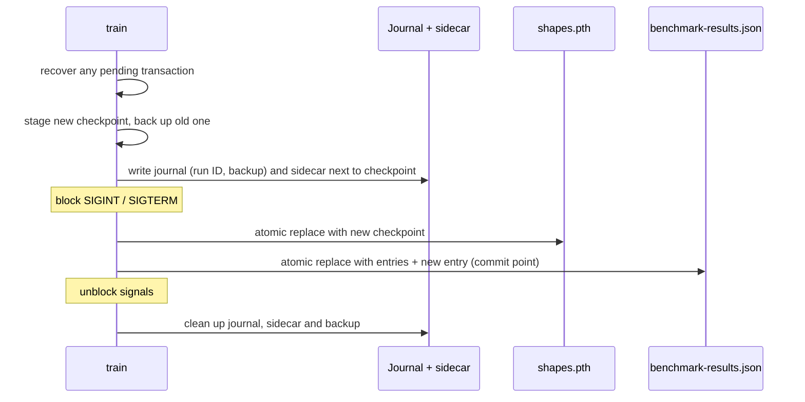

Before the commit point, recovery restores the old checkpoint, or removes the new one if there
was none, and no entry exists. After it, the run counts as complete. `evaluate`, `predict` and
`summary` run recovery first. The sidecar stores the journal's location relative to the
checkpoint, so recovery works under both the Docker and the native path. If a recorded location
can't be reached, recovery fails clearly and keeps the journal.

### 5.5 Predict one image

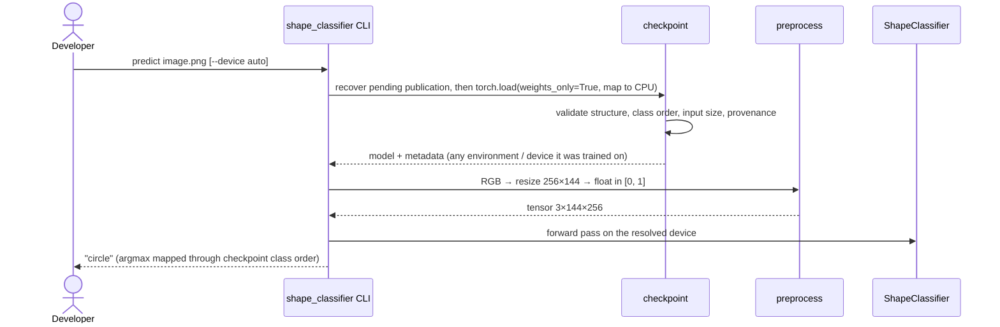

## 6. Core model

A deliberately tiny CNN: two convolution blocks, global average pooling and one linear layer.
It has **5,187 trainable parameters**.

| Setting | Value | Why |
|---|---|---|
| Input | 1920×1080 resized to 256×144, RGB, scaled to [0, 1], no normalization | Same aspect ratio; small enough for fast CPU training |
| Augmentation (training only) | Rotation ±10°, horizontal and vertical flip (p = 0.5), brightness / contrast / saturation jitter 0.1 | Only 30 training images; teaches invariance to pose and color |
| Optimizer | Adam, learning rate 0.001, cross-entropy loss | Standard, robust defaults |
| Epochs / batch | **60** / 8 | 60 chosen in feature 003 from training data only (see §10) |
| Determinism | Seed 42, `torch.use_deterministic_algorithms(True)` | Reproducible within documented limits |
| CPU threads | All cores available to the environment (2 in the Docker VM here, 10 natively) | Fair speed comparison against MPS (feature 004); repeats may differ slightly |

## 7. Data and artifacts

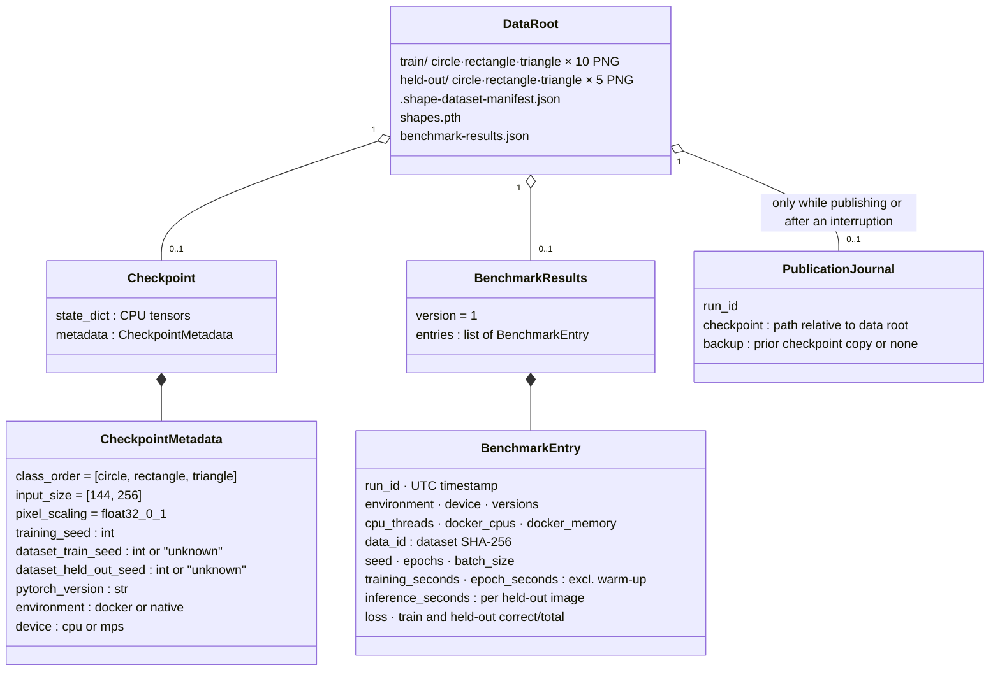

The summary groups entries by **dataset fingerprint, seed, epochs and batch size**, so runs on
different data or settings are never averaged together. Each group always lists Docker CPU,
native CPU and native MPS, marking any that haven't been measured.

The checkpoint is portable: it loads in any environment, on any device. It is **rejected** only
when it doesn't match what the code expects:

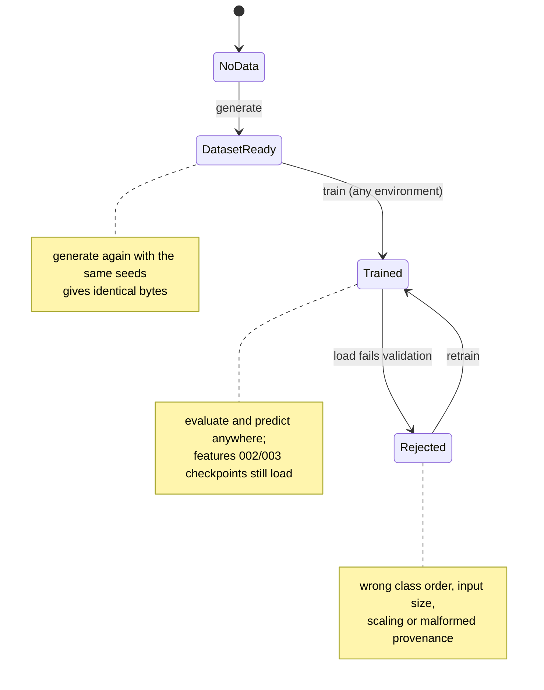

## 8. Runtime and deployment

| Item | Docker (default) | Native macOS (optional) |
|---|---|---|
| Python | `python:3.14.10-slim`, arm64 Linux | 3.14.10 in a `uv` virtual environment (patch version verified) |
| PyTorch | `torch==2.15.0+cpu`, `torchvision==0.29.2+cpu` | `torch==2.15.0`, `torchvision==0.29.2` (standard build with MPS) |
| Other packages | Same exact pins from the one shared `requirements.txt`, selected by platform markers | Same |
| Devices | CPU only (Docker on macOS has no GPU access) | CPU or MPS |
| Data | Host `./data` mounted at `/data` | The same `./data` folder by host path |
| Entry points | `python -m shape_dataset`; `--entrypoint python … -m shape_classifier {train,evaluate,predict,summary}` | `.venv/bin/python -m shape_classifier …` with explicit `--data-dir` and `--checkpoint` |
| Tests | Built into the image: `python -m unittest discover -s tests` | Same suite; the cross-environment recovery test runs with `SHAPE_CROSS_ENV=1` |

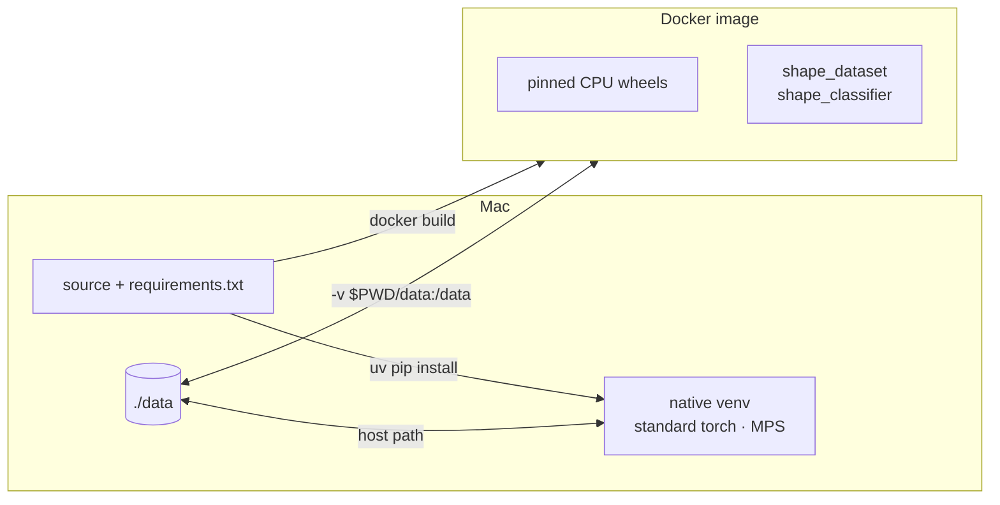

## 9. Quality attributes

| Attribute | How the design achieves it | Evidence |
|---|---|---|
| **Reproducibility** | Separate seeded generators per set; fixed PNG settings; seeded, deterministic training where supported; one shared set of pins; multithread and MPS limits documented | `tests/test_reproducibility.py`; native CPU repeats matched in accuracy and loss, times 2.3% apart |
| **Truthful device reporting** | Environment detected, MPS probed with a real operation, explicit `mps` never falls back silently | `tests/test_device.py` |
| **Data integrity (dataset)** | Exclusive lock, staging, SHA-256 journal, atomic replace, manifest of owned files | `tests/test_output.py` |
| **Data integrity (benchmark)** | Checkpoint-then-results publication with a durable journal, signal blocking, rollback on failure, recovery before every read | `tests/test_publication.py` (failure injection, interruption before and after commit, inaccessible locations) |
| **Comparable results** | Dataset fingerprint plus settings as the grouping key; strict entry validation; malformed files left untouched | `tests/test_results.py`, `tests/test_benchmark.py` |
| **Safe model loading** | `weights_only=True`, strict key match, metadata validation, CPU-mapped load | `tests/test_checkpoint.py`, `tests/test_classifier.py` |
| **Honest reporting** | Training and held-out accuracy always together; summary caveats; slower GPU results still published | CLI output; README |

## 10. Results and limitations

**Epoch count (feature 003).** Three epoch counts were compared on the same data. One was chosen
**using training data only** and frozen before the held-out set was evaluated:

| Epochs | Training | Held-out | Training-loop time |
|---:|---:|---:|---:|
| 30 | 16/30 (0.53) | 7/15 (0.47) | 21.6 s |
| **60 (default)** | **19/30 (0.63)** | **6/15 (0.40)** | **45.7 s** |
| 120 | 24/30 (0.80) | 5/15 (0.33) | 87.5 s |

Those times were measured with one CPU thread, before feature 004 switched to all cores.

**Device benchmark (feature 004).** Default settings (seed 42, 60 epochs, batch 8), same data,
on an M1 Pro:

| Configuration | Runs | Training time (excl. 1st epoch) | Inference per image | Training | Held-out |
|---|---:|---:|---:|---:|---:|
| Docker CPU (2 threads) | 1 | 24.6 s | 2.42 ms | 19/30 | 6/15 |
| Native CPU (10 threads) | 2 | 9.3 s | 1.20 ms | 20/30 | 6/15 |
| Native MPS | 1 | 6.9 s | 0.57 ms | 18/30 | 6/15 |

**How to read this honestly:**

- Longer training raises training accuracy but **not** held-out accuracy. That is a sign of
  overfitting to 30 images.
- With 15 held-out images, one image is about 6.7 percentage points, so the differences between
  rows are within noise. All three devices reached the same 6/15 held-out.
- Docker had only 2 of the Mac's 10 cores, so its row mixes the effect of the environment with
  the effect of fewer cores; these runs can't separate the two. MPS was fastest here, but for a
  model this small that isn't guaranteed. Timing varies with machine load.
- Held-out accuracy around 0.4 is only slightly better than random guessing (0.33). The model
  is a teaching example, not a reliable classifier.

## 11. Decision log

| # | Decision | Why | Source |
|---|---|---|---|
| D1 | Draw shapes with Pillow; reject triangles with any angle below 20° and shapes with an inner circle below 120 px | Every image is clearly recognizable after resizing | [001 research: drawing and geometry](../../specs/001-generate-shape-dataset/research.md#drawing-and-geometry) |
| D2 | Contrast ratio ≥ 3:1 using the W3C luminance formula | Shape is always visible against the background | [001 research: contrast](../../specs/001-generate-shape-dataset/research.md#contrast) |
| D3 | Separate seeds 42 / 43 for training and held-out | One set can change without affecting the other | [001 research: seeds](../../specs/001-generate-shape-dataset/research.md#seeds-and-encoding) |
| D4 | Lock + stage + journal + manifest for publishing images | Re-runs and interruptions never corrupt data or delete user files | [001 research: safe repeat runs](../../specs/001-generate-shape-dataset/research.md#safe-repeat-runs) |
| D5 | CPU-only PyTorch wheels in Docker, all packages pinned | Small image, reproducible on arm64 | [002 research: dependencies](../../specs/002-cnn-training-prediction/research.md#dependencies-and-runtime) |
| D6 | Keep `shape_dataset` as the Docker entry point; classifier via `--entrypoint` | Feature 001 commands keep working | [002 research: CLI](../../specs/002-cnn-training-prediction/research.md#cli-compatibility) |
| D7 | One shared preprocessing pipeline, no normalization; augmentation only in training | Constitution principle IV; no train/serve mismatch | [002 research: preprocessing](../../specs/002-cnn-training-prediction/research.md#preprocessing-and-augmentation) |
| D8 | Two conv blocks + global pooling + linear head; Adam 0.001, batch 8 | Smallest model that can learn the task | [002 research: training](../../specs/002-cnn-training-prediction/research.md#training-and-honest-evaluation) |
| D9 | Checkpoint = CPU state dict + plain metadata, validated on load | Safe loading, clear errors for incompatible files | [002 research: checkpoint](../../specs/002-cnn-training-prediction/research.md#checkpoint-and-provenance) |
| D10 | Default epochs raised from 30 to 60 using a rule fixed in advance, on training data only | Evidence-based default without leaking held-out data | [003 research: decision rule](../../specs/003-improve-default-training/research.md#evidence-and-decision-rule) |
| D11 | Detect the container; probe MPS with a real operation; resolve before any write; explicit `mps` never falls back | Availability alone doesn't prove usability; a silent fallback would invalidate results | [004 research: device resolution](../../specs/004-device-benchmark/research.md#device-resolution) |
| D12 | One requirements file with platform markers (CPU wheels on Linux, standard wheels on macOS) | Same versions everywhere without two drifting files | [004 research: shared dependencies](../../specs/004-device-benchmark/research.md#shared-dependencies) |
| D13 | All available CPU cores; synchronize MPS around timers; exclude the first epoch | Fair comparison; queued GPU work would otherwise look too fast | [004 research: threads and timing](../../specs/004-device-benchmark/research.md#threads-and-timing) |
| D14 | Group results by a SHA-256 dataset fingerprint plus settings; versioned JSON, atomic replace, sequential use only | Paths and seeds don't identify data; advisory locks didn't work across the Docker mount | [004 research: comparable results](../../specs/004-device-benchmark/research.md#comparable-durable-results) |
| D15 | Record the actual environment and device in checkpoints; accept any, keep validating preprocessing | Portable models; features 002/003 checkpoints keep loading | [004 research: checkpoints](../../specs/004-device-benchmark/research.md#checkpoints-and-evaluation) |
| D16 | Publish checkpoint first, results last as the commit point, with a journal and sidecar for recovery | A results-save failure must not change the existing checkpoint | [004 research: publishing](../../specs/004-device-benchmark/research.md#publishing-checkpoint-and-results) |

## 12. Evolution

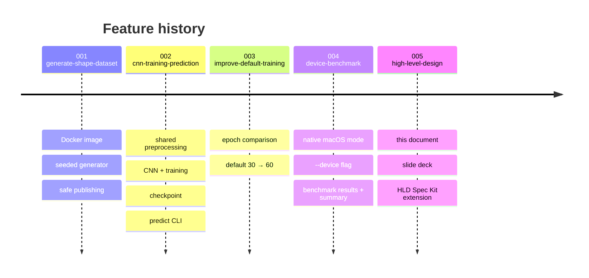

## 13. Open questions and roadmap

- > **Open question:** held-out accuracy is close to chance on every device. Would a larger
  > generated dataset improve it more than training for longer does? Nothing has measured that yet.
- > **Open question:** the cross-environment recovery test (Docker and native sharing one
  > interrupted publication) only runs when `SHAPE_CROSS_ENV=1` is set on a machine with both
  > environments. It isn't part of the default Docker test run.
- **By design:** running commands concurrently against the same checkpoint or results file is
  unsupported and not detected. Supporting it would need a cross-environment lock, which
  advisory file locks did not provide on the tested Docker mount.

## Glossary

| Term | Meaning |
|---|---|
| **Held-out set** | Images never used for training or for choosing settings; the honest test of generalization |
| **Augmentation** | Random rotations, flips and color changes applied to training images on every epoch |
| **Epoch** | One pass over all 30 training images |
| **Warm-up epoch** | The first epoch, excluded from training times because it includes one-off setup costs |
| **Checkpoint** | The saved model file `shapes.pth`: weights plus metadata |
| **Benchmark entry** | One completed training run's environment, settings, timings and paired accuracy |
| **Dataset fingerprint** | SHA-256 over the relative paths and bytes of both image sets; identifies the exact data a run used |
| **Journal** | A file that records an in-progress publish so it can be finished or rolled back after a crash |
| **Sidecar** | `<checkpoint>.transaction`, a pointer next to the checkpoint that lets any command find the journal |
| **Manifest** | The list of image files the generator owns and is allowed to replace or delete |
| **MPS** | Metal Performance Shaders, Apple's GPU backend for PyTorch |
