# High-Level Design: Synthetic Shape Classifier

| | |
|---|---|
| **Status** | Living document, regenerated by `/speckit-hld-generate` (Codex: `$speckit-hld-generate`) |
| **Updated** | 2026-11-07 at commit `a1efeb2` |
| **Features covered** | 001-generate-shape-dataset, 002-cnn-training-prediction, 003-improve-default-training |
| **Audience** | New contributors, reviewers, and anyone learning how the pieces fit together |
| **Sources** | [constitution](../../.specify/memory/constitution.md), [requirements](../../CNN_image_classification_research.md), [`specs/`](../../specs), `src/`, `Dockerfile` |
| **Slides** | [`slides.md`](slides.md): run `npm install && npm run dev` in this folder |

## 1. Purpose and scope

The system is a small learning project. It **generates synthetic images** of filled circles,
rectangles and triangles, **trains a tiny convolutional neural network (CNN)** on them, and then
**classifies new images** into one of those three shapes. Everything runs on the CPU inside Docker
and is reproducible from fixed seeds.

**Out of scope today:** GPU or MPS training (planned as feature 004), real-world photos, more
classes, serving a model over a network, and hyperparameter search.

## 2. Guiding principles

The [constitution](../../.specify/memory/constitution.md) shapes every design choice:

| Principle | What it means for the design |
|---|---|
| **I. Simplicity** | Two small Python packages, a ~5k-parameter CNN, the standard library `unittest`, no framework on top of PyTorch |
| **II. Reproducibility** | Fixed, overridable seeds (data 42/43, training 42); pinned Python 3.14.10 and every package; deterministic PyTorch on one thread; Docker as the default runtime |
| **III. Honest evaluation** | A separate **held-out** set is always reported next to training accuracy and is never used to pick models or settings |
| **IV. Shared preprocessing** | Training, evaluation and prediction import **one** preprocessing definition |
| **V. Conventional Commits** | Enforced by a `commit-msg` hook (see [`AGENTS.md`](../../AGENTS.md)) |

## 3. System context

One person runs three kinds of commands through Docker. The only shared state is a mounted
`data/` folder that holds the images and the trained model.

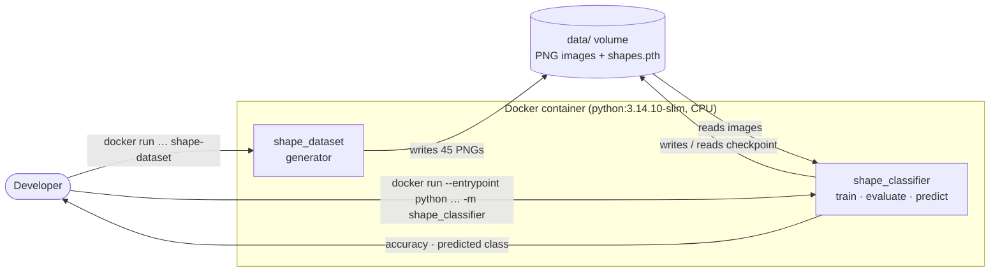

## 4. Building blocks

The code is two packages in one image. `shape_dataset` knows nothing about machine learning;
`shape_classifier` only depends on the folder layout the generator produces.

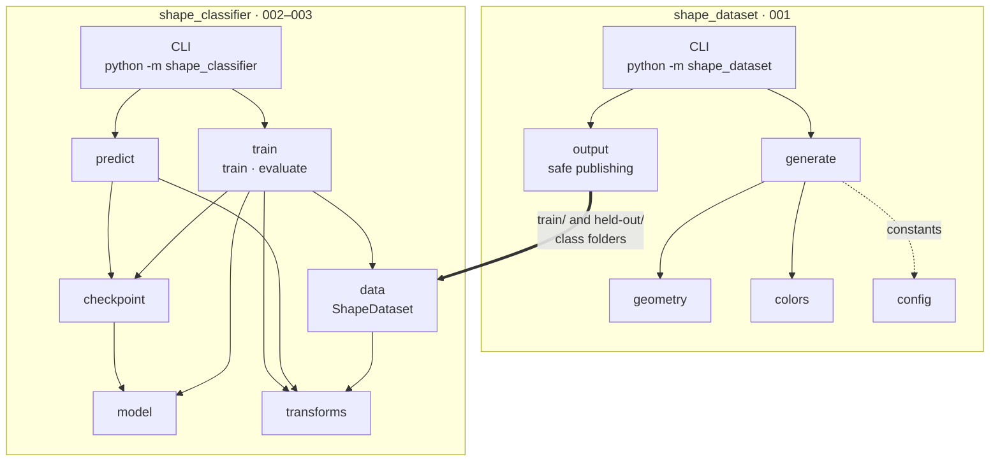

| Module | Responsibility | Introduced by |
|---|---|---|
| `shape_dataset/config.py` | Canvas size (1920×1080), class names, images per set, default seeds | 001 |
| `shape_dataset/geometry.py` | Samples one shape inside the canvas with size, rotation and angle limits | 001 |
| `shape_dataset/colors.py` | Random background and foreground with contrast of at least 3:1 | 001 |
| `shape_dataset/generate.py` | Draws every image in memory, guarantees variation within each set | 001 |
| `shape_dataset/output.py` | Lock, stage, journal and atomically publish images; recover after interruption | 001 |
| `shape_classifier/transforms.py` | The one shared `preprocess` pipeline and the training-only `augment` pipeline | 002 |
| `shape_classifier/data.py` | Validates the folder layout and caches preprocessed tensors | 002 |
| `shape_classifier/model.py` | The CNN architecture, used for both training and loading | 002 |
| `shape_classifier/train.py` | Deterministic training loop and paired train / held-out assessment | 002, 003 |
| `shape_classifier/checkpoint.py` | Atomic save and strict validation of the `.pth` file | 002 |
| `shape_classifier/predict.py` | Classifies one image using the checkpoint's class order | 002 |

## 5. Key flows

The whole system is one pipeline. Each stage is a separate command, so stages can be re-run
independently.

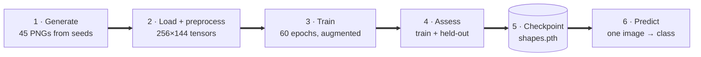

### 5.1 Generate the dataset

Each set (training, held-out) has its own random generator, so changing one seed never changes
the other set. A candidate shape is redrawn until it satisfies every rule.

Publishing never leaves the folder half-written and never deletes files it did not create:

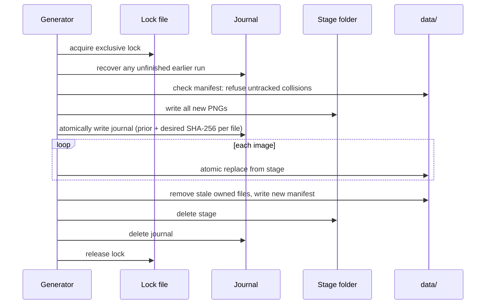

If the process is killed at any step, the next run finds the journal and completes it before
doing anything else.

### 5.2 Train and assess

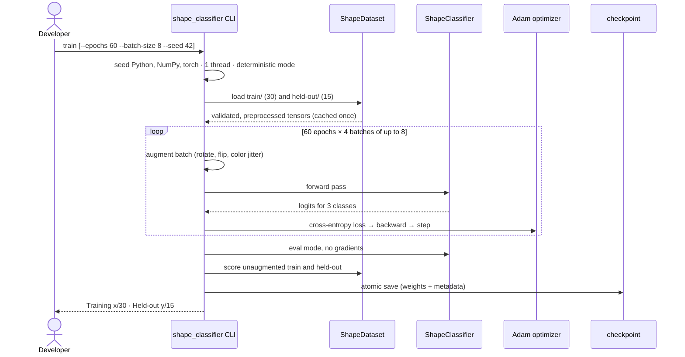

`evaluate` repeats only the last scoring steps against an existing checkpoint.

### 5.3 Predict one image

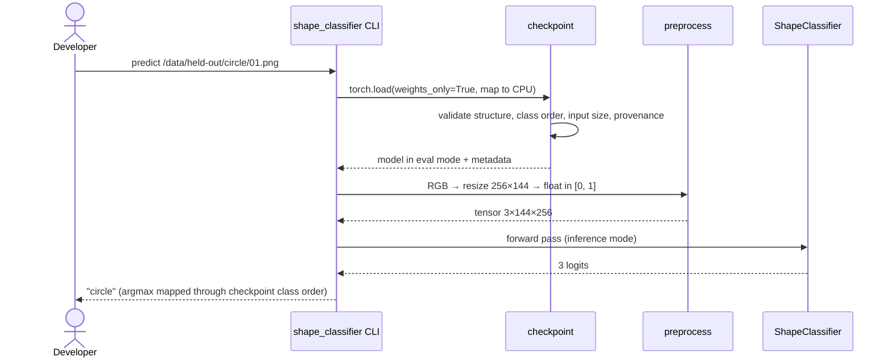

## 6. Core model

A deliberately tiny CNN: two convolution blocks, global average pooling and one linear layer.
It has **5,187 trainable parameters**.

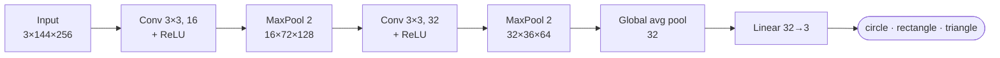

| Setting | Value | Why |
|---|---|---|
| Input | 1920×1080 resized to 256×144, RGB, scaled to [0, 1], no normalization | Same aspect ratio; small enough for fast CPU training |
| Augmentation (training only) | Rotation ±10°, horizontal and vertical flip (p = 0.5), brightness / contrast / saturation jitter 0.1 | Only 30 training images; teaches invariance to pose and color |
| Optimizer | Adam, learning rate 0.001, cross-entropy loss | Standard, robust defaults |
| Epochs / batch | **60** / 8 | 60 chosen in feature 003 from training data only (see §10) |
| Determinism | Seed 42, one CPU thread, `torch.use_deterministic_algorithms(True)` | Repeat runs give the same result in the same image |

## 7. Data and artifacts

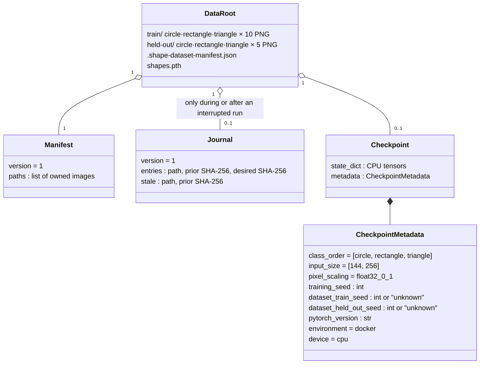

The checkpoint records where it came from and is **rejected** when loaded if anything doesn't
match what the code expects:

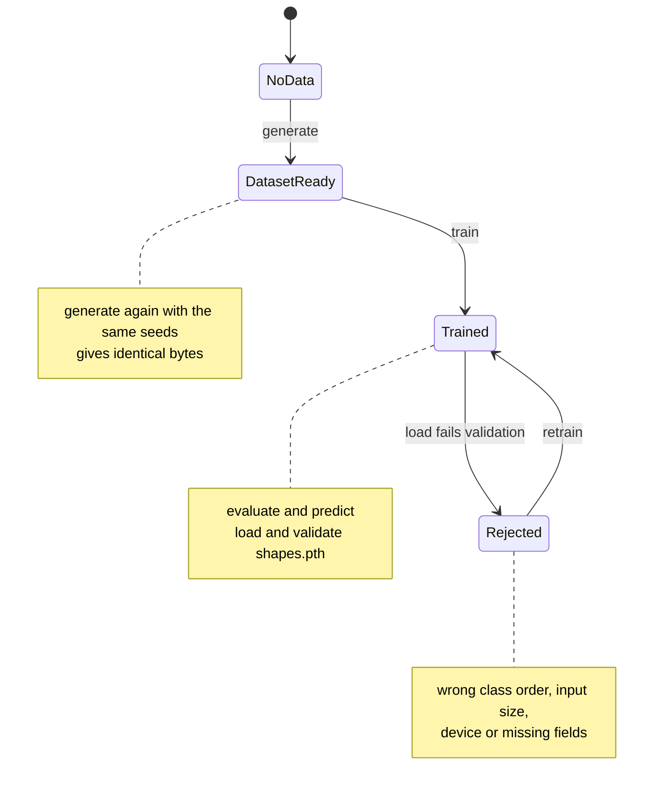

## 8. Runtime and deployment

| Item | Value |
|---|---|
| Base image | `python:3.14.10-slim`, arm64 Linux |
| ML stack | `torch==2.15.0+cpu`, `torchvision==0.29.2+cpu`, `numpy==2.5.4`, from the PyTorch CPU index |
| Imaging | `Pillow==13.0.0` |
| Pins | Every direct and transitive package pinned in `requirements.txt` |
| Default entry point | `python -m shape_dataset` |
| Classifier entry point | `--entrypoint python … -m shape_classifier {train,evaluate,predict}` |
| Data | Host `./data` mounted at `/data`; checkpoint at `/data/shapes.pth` |
| Tests | Built into the image: `python -m unittest discover -s tests` |

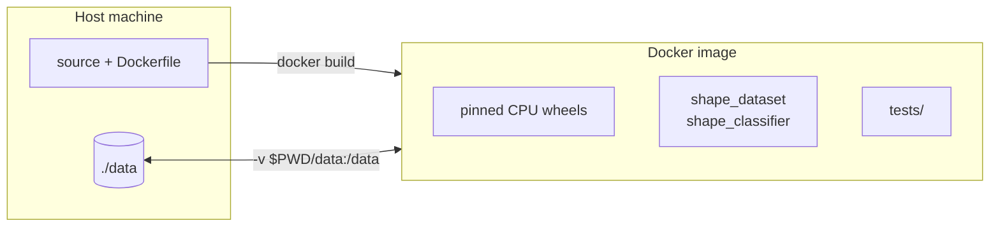

## 9. Quality attributes

| Attribute | How the design achieves it | Evidence |
|---|---|---|
| **Reproducibility** | Separate seeded generators per set; fixed iteration order and PNG settings; seeded, single-threaded, deterministic training; pinned environment | `tests/test_reproducibility.py` (byte-identical images); repeat-training check in feature 003 |
| **Data integrity** | Exclusive lock, staging, SHA-256 journal, atomic replace, manifest of owned files, symlink and path-traversal rejection | `tests/test_output.py` (interruption at each step, collisions) |
| **Correct inputs** | Dataset loader requires exact folders, exact counts (10 / 5) and valid PNGs | `tests/test_classifier.py` |
| **Safe model loading** | `weights_only=True`, strict key match, metadata validation, atomic save | `tests/test_classifier.py` |
| **Shape quality** | Contrast ≥ 3:1, inner circle ≥ 120 px (≈ 16 px after resize), triangle angles ≥ 20° | `tests/test_geometry.py`, `tests/test_generation.py` |
| **Honest reporting** | Every run prints training and held-out accuracy together; held-out data never steers choices | CLI output; [comparison record](../../specs/003-improve-default-training/comparison.md) |

## 10. Results and limitations

Feature 003 compared three epoch counts on the same data, chose one **using training data only**,
froze the decision, and only then evaluated the held-out set:

| Epochs | Training | Held-out | Training-loop time |
|---:|---:|---:|---:|
| 30 | 16/30 (0.53) | 7/15 (0.47) | 21.6 s |
| **60 (default)** | **19/30 (0.63)** | **6/15 (0.40)** | **45.7 s** |
| 120 | 24/30 (0.80) | 5/15 (0.33) | 87.5 s |

**How to read this honestly:**

- Longer training raises training accuracy but **not** held-out accuracy. That is a sign of
  overfitting to 30 images.
- With 15 held-out images, one image is about 6.7 percentage points, so the differences between
  rows are within noise.
- Held-out accuracy around 0.4 is only slightly better than random guessing (0.33). The model
  is a teaching example, not a reliable classifier.

## 11. Decision log

| # | Decision | Why | Source |
|---|---|---|---|
| D1 | Draw shapes with Pillow; reject triangles with any angle below 20° and shapes with an inner circle below 120 px | Every image is clearly recognizable after resizing | [001 research: drawing and geometry](../../specs/001-generate-shape-dataset/research.md#drawing-and-geometry) |
| D2 | Contrast ratio ≥ 3:1 using the W3C luminance formula | Shape is always visible against the background | [001 research: contrast](../../specs/001-generate-shape-dataset/research.md#contrast) |
| D3 | Separate seeds 42 / 43 for training and held-out | One set can change without affecting the other | [001 research: seeds](../../specs/001-generate-shape-dataset/research.md#seeds-and-encoding) |
| D4 | Lock + stage + journal + manifest for publishing | Re-runs and interruptions never corrupt data or delete user files | [001 research: safe repeat runs](../../specs/001-generate-shape-dataset/research.md#safe-repeat-runs) |
| D5 | CPU-only PyTorch wheels, all packages pinned | Small image, reproducible on arm64 | [002 research: dependencies](../../specs/002-cnn-training-prediction/research.md#dependencies-and-runtime) |
| D6 | Keep `shape_dataset` as the Docker entry point; classifier via `--entrypoint` | Feature 001 commands keep working | [002 research: CLI](../../specs/002-cnn-training-prediction/research.md#cli-compatibility) |
| D7 | One shared preprocessing pipeline, no normalization; augmentation only in training | Constitution principle IV; no train/serve mismatch | [002 research: preprocessing](../../specs/002-cnn-training-prediction/research.md#preprocessing-and-augmentation) |
| D8 | Two conv blocks + global pooling + linear head; Adam 0.001, batch 8 | Smallest model that can learn the task | [002 research: training](../../specs/002-cnn-training-prediction/research.md#training-and-honest-evaluation) |
| D9 | Checkpoint = CPU state dict + plain metadata, validated on load | Safe loading, clear errors for incompatible files | [002 research: checkpoint](../../specs/002-cnn-training-prediction/research.md#checkpoint-and-provenance) |
| D10 | Default epochs raised from 30 to 60 using a rule fixed in advance, on training data only | Evidence-based default without leaking held-out data | [003 research: decision rule](../../specs/003-improve-default-training/research.md#evidence-and-decision-rule) |

## 12. Evolution

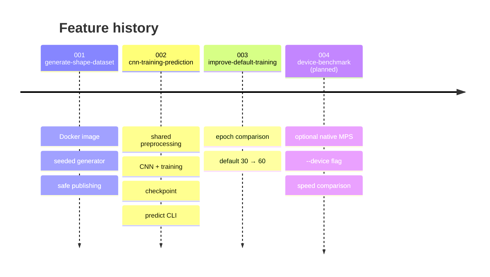

## 13. Open questions and roadmap

- **Feature 004 (planned):** optional native macOS run on the Mac GPU (MPS) with a `--device`
  flag, failing clearly if the requested device is unavailable, plus a timing comparison of
  Docker CPU, native CPU and native MPS. The checkpoint metadata currently fixes
  `environment = docker` and `device = cpu`, so this feature will need to relax that validation.
- > **Open question:** held-out accuracy is close to chance. Would a larger generated dataset
  > improve it more than training for longer does? Nothing has measured that yet.
- > **Open question:** the CLI always reports `Environment: docker; device: cpu`, even when it is
  > run outside Docker. Feature 004 should report the real environment.

## Glossary

| Term | Meaning |
|---|---|
| **Held-out set** | Images never used for training or for choosing settings; the honest test of generalization |
| **Augmentation** | Random rotations, flips and color changes applied to training images on every epoch |
| **Epoch** | One pass over all 30 training images |
| **Checkpoint** | The saved model file `shapes.pth`: weights plus metadata |
| **Journal** | A temporary file that records an in-progress publish so it can be finished after a crash |
| **Manifest** | The list of image files the generator owns and is allowed to replace or delete |
| **MPS** | Metal Performance Shaders, Apple's GPU backend for PyTorch |
