# Synthetic Shape Classifier

High-Level Design

2026-11-07 · features 001–005 · commit 83b41d9

<!--
A tiny, fully reproducible machine-learning pipeline: generate pictures of shapes, train a small CNN, classify new pictures.
-->

---

# What it does

<v-clicks>

- **Generates** 45 synthetic 1920×1080 images: circles, rectangles and triangles
- **Trains** a tiny CNN (5,187 parameters) on 30 of them
- **Reports** accuracy on the 15 held-out images it never saw
- **Classifies** any new image into one of the three shapes
- Runs in **Docker on the CPU** by default, or **natively on the Mac's CPU or GPU (MPS)**
- **Benchmarks** every training run and compares the three configurations

</v-clicks>

Out of scope today: real photos, more classes, network serving, concurrent runs.

<!--
It's a learning project. The value is in the process (reproducibility, honest evaluation), not in accuracy.
-->

---

# Guiding principles

| Principle | In the design |
|---|---|
| Simplicity | 2 small packages, ~5k-parameter CNN, `unittest` |
| Reproducibility | Seeds 42 / 43 / 42, one shared set of pins, deterministic where supported |
| Honest evaluation | Held-out accuracy always shown; slower GPU results still published |
| Shared preprocessing | One pipeline for train, evaluate and predict |
| Conventional Commits | `commit-msg` hook, plus a feature-number check |

<!--
These five come from the Spec Kit constitution. Every spec and plan was checked against them.
-->

---

# System context

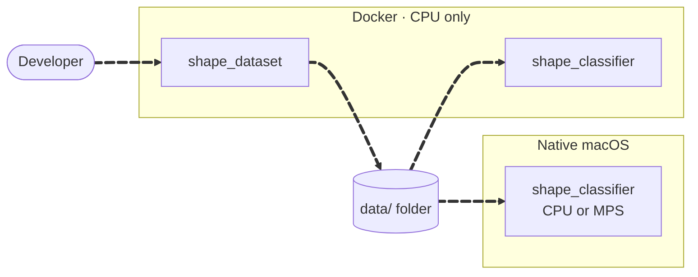

<v-clicks>

- Same code and package versions in both environments
- The `data/` folder is the **only** shared state: PNGs, `shapes.pth`, `benchmark-results.json`
- Commands touching the same outputs run **one at a time**

</v-clicks>

<!--
The two packages never call each other. They only agree on the folder layout. Docker can't reach the Mac's GPU, which is why the native mode exists.
-->

---

# The pipeline · 1 of 4

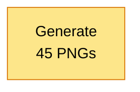

Seeds **42** (training) and **43** (held-out) → byte-identical images every run.

<!--
We build the pipeline one stage at a time.
-->

---

# The pipeline · 2 of 4

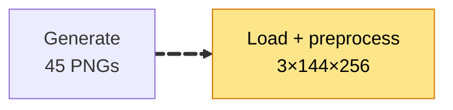

Resize to 256×144, scale to [0, 1]. **The same code** is used later for prediction.

---

# The pipeline · 3 of 4

Augmentation every epoch: rotate ±10°, flip, jitter color. Each epoch is timed; then score **both** sets.

---

# The pipeline · 4 of 4

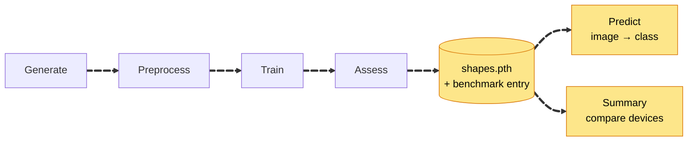

Every training run publishes a portable checkpoint **and** one benchmark entry.

<!--
That's the whole system. The next slides zoom into each stage.
-->

---
layout: two-cols
---

# Choosing the device

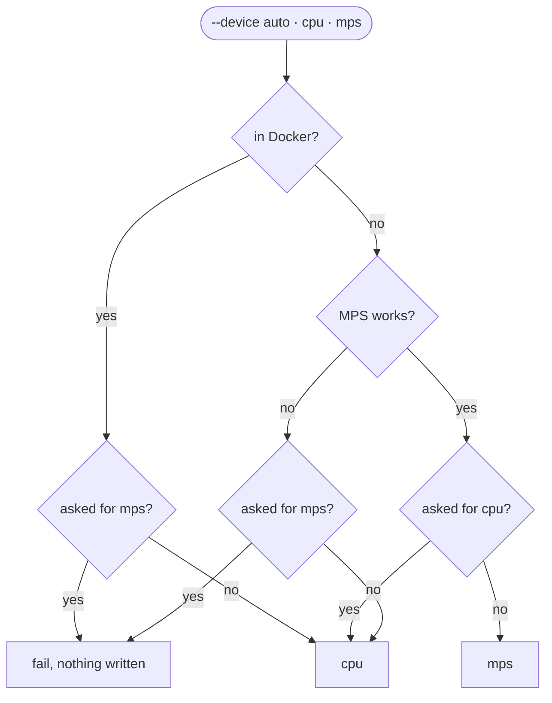

::right::

<v-clicks>

- Resolved **before** any data is read or file written
- MPS is probed with a real operation, not just "available"
- Asking for `mps` where it can't run **fails**. It never quietly uses the CPU
- Every run prints its real environment, device and versions

</v-clicks>

<!--
A silent fallback would make a "GPU" benchmark actually measure the CPU. That's why explicit mps fails loudly.
-->

---

# Building blocks

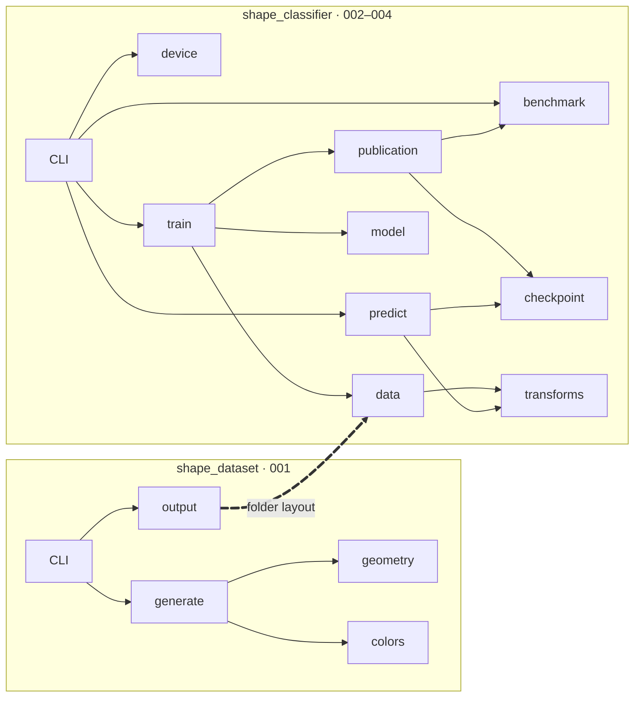

<v-clicks>

- `shape_dataset` knows nothing about ML
- `transforms` is the single shared preprocessing definition
- `device` decides where work runs; `publication` writes checkpoint and results safely
- `benchmark` validates entries and prints the comparison

</v-clicks>

---
layout: two-cols
---

# Generating a shape

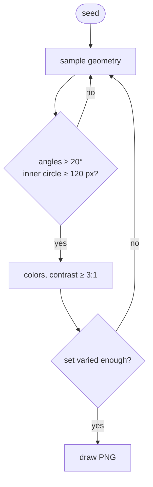

::right::

<v-clicks>

- Separate random generators for training and held-out, so one seed never affects the other set
- Rejection sampling: redraw until **every** rule holds
- 120 px inner circle ≈ 16 px after resizing, so the shape stays visible
- Variation check: every set has at least 2 distinct positions, sizes, colors and orientations
- Squares are allowed as rectangles (about 1 in 8)

</v-clicks>

---

# Publishing safely

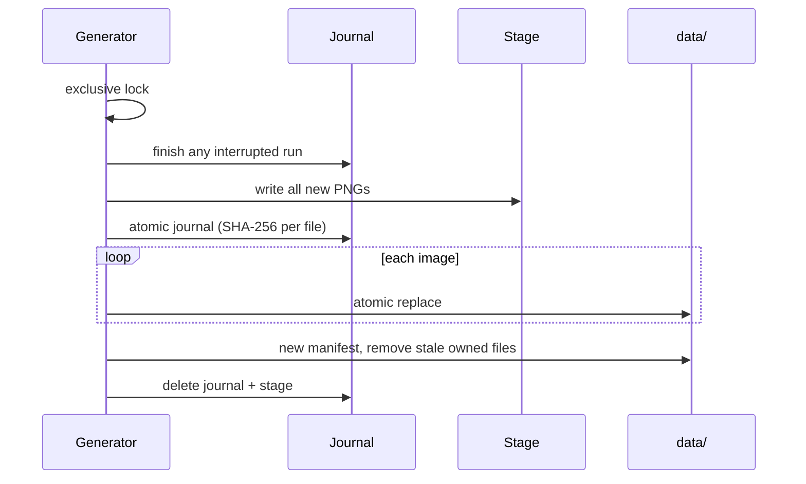

Kill the process at any point and the next run **finishes the job**. Files the generator didn't create are never touched.

---

# Training and assessment

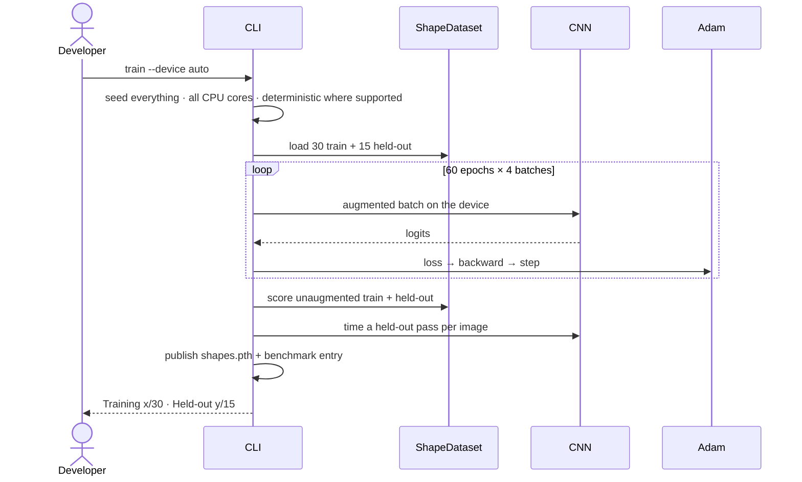

The first epoch is excluded from timing (warm-up); MPS is synchronized before each timer read.

---

# Publishing checkpoint and results

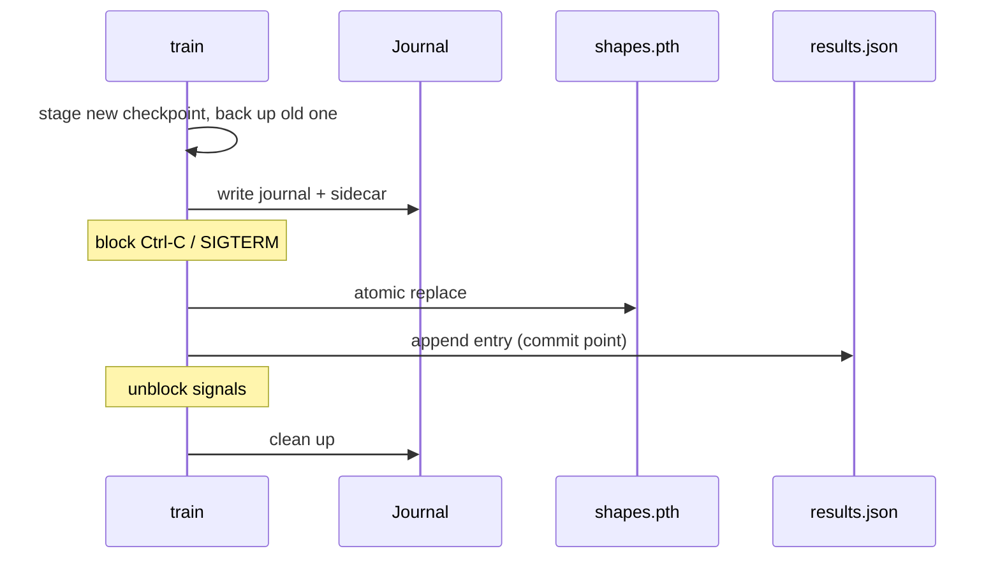

<v-clicks>

- Before the commit point: the old checkpoint comes back and no entry exists
- After it: the run is complete, even if the process is killed right away
- `evaluate`, `predict` and `summary` finish any interrupted publication first

</v-clicks>

<!--
Two files can't be replaced in one atomic step, so a journal makes the pair recoverable, across Docker and native paths.
-->

---

# The model

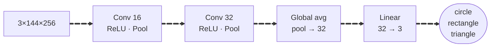

<v-clicks>

- **5,187** trainable parameters
- Adam, learning rate 0.001, batch 8, **60 epochs**
- Global pooling makes the head independent of the image size

</v-clicks>

---
layout: two-cols
---

# Predicting

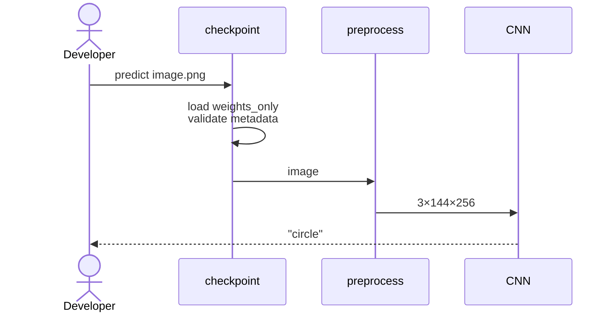

::right::

<v-clicks>

- `torch.load(weights_only=True)`, mapped to CPU
- Loads on **any** device, whichever environment trained it; 002/003 checkpoints still work
- Rejects the file if the class order, input size, scaling or provenance fields are wrong
- The class name comes from the **checkpoint's** class order, not from the code

</v-clicks>

---

# Results: honest numbers

Epoch count chosen **from training data only**, frozen, *then* held-out evaluated (feature 003).

| Epochs | Training | Held-out | Loop time |
|---:|---:|---:|---:|
| 30 | 16/30 (0.53) | 7/15 (0.47) | 21.6 s |
| **60** | **19/30 (0.63)** | **6/15 (0.40)** | 45.7 s |
| 120 | 24/30 (0.80) | 5/15 (0.33) | 87.5 s |

<v-clicks at="2">

- Training accuracy rises; held-out does not, which points to **overfitting** on 30 images
- One held-out image ≈ 6.7 points, so the differences are within noise
- Held-out ≈ 0.4 vs 0.33 for random guessing: a teaching model, not a reliable classifier

</v-clicks>

<!--
We publish unfavorable numbers on purpose. That's constitution principle III.
-->

---

# Results: device benchmark

Default settings (seed 42, 60 epochs, batch 8), same data, M1 Pro (feature 004).

| Configuration | Training time* | Inference / image | Training | Held-out |
|---|---:|---:|---:|---:|
| Docker CPU (2 threads) | 24.6 s | 2.42 ms | 19/30 | 6/15 |
| Native CPU (10 threads) | 9.3 s | 1.20 ms | 20/30 | 6/15 |
| Native MPS | **6.9 s** | 0.57 ms | 18/30 | 6/15 |

* excluding the first (warm-up) epoch

<v-clicks at="2">

- MPS was fastest here, but for a model this small that isn't guaranteed
- Docker had only 2 of 10 cores, so its row mixes environment and core count
- Accuracy is the same on held-out: devices change speed, not what the model learns

</v-clicks>

<!--
Native CPU was run twice: identical accuracy and loss, times 2.3 percent apart.
-->

---

# Key decisions

<v-clicks>

- **Rejection sampling** with angle, size and contrast rules → every shape is recognizable
- **Separate seeds** per set → independent, reproducible sets
- **Lock + journal + manifest** → reruns and crashes never corrupt data
- **CPU wheels, everything pinned** → small, reproducible image
- **One preprocessing pipeline, no normalization** → no train/serve mismatch
- **Validated checkpoint metadata** → clear errors instead of silent wrong answers
- **Epochs chosen by a pre-declared rule** → no held-out leakage
- **Explicit device, no silent fallback** → benchmarks measure what they claim
- **Dataset fingerprint as the grouping key** → only like is compared with like
- **Checkpoint first, results last, with a journal** → a failed save never changes the old model

</v-clicks>

Full log with links: docs/hld/hld.md §11

---

# Evolution

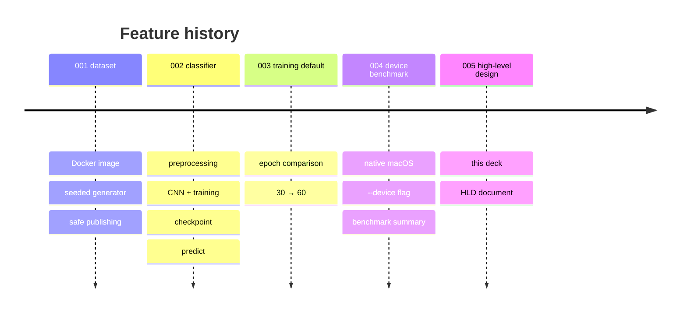

Open question: held-out accuracy is near chance on every device. Would more data help more than more epochs?

---
layout: center
class: text-center
---

# Questions?

Document: `docs/hld/hld.md` · Regenerate: `/speckit-hld-generate`, then `/speckit-hld-slides`

